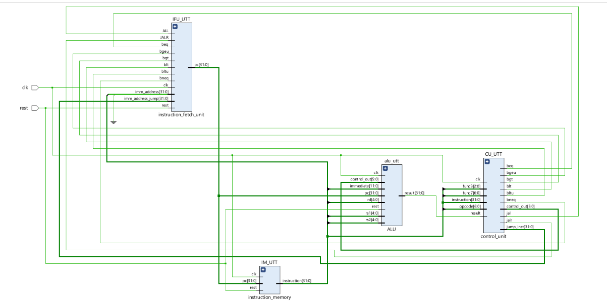
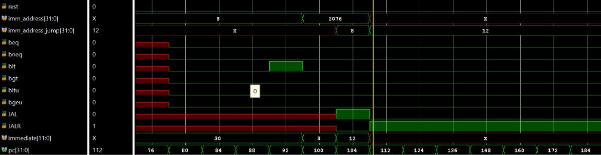
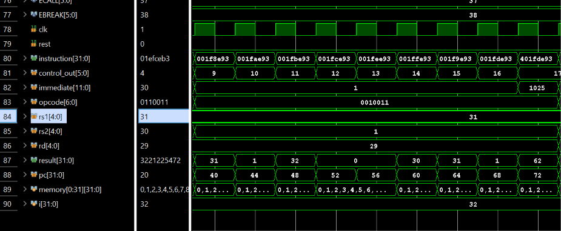

# RV32I Processor RTL: Design Guide

This repository contains a learning-oriented Verilog processor structure. The RTL is split into independent modules under [`rtl_sim/`](rtl_sim/); expand that folder in the file explorer to open each module separately. This README explains their interfaces, responsibilities, connections, and current limitations, without embedding RTL listings.

## Architecture at a glance

The processor’s current path is:

1. The instruction fetch unit holds the program counter (PC).
2. Instruction memory reads a 32-bit instruction using the PC.
3. The control unit decodes the instruction opcode and forms immediate and flow-control signals.
4. The fetch unit uses branch/jump control to select the next PC, or advances by four bytes.
5. The ALU produces a registered result from the operands connected at the top level.

The block diagram below shows how the design’s modules and signals are wired. It represents the supplied design diagram; the current RTL is a simplified scaffold, and not every datapath shown is fully implemented.

## Module summary

| Module | RTL source | Main responsibility |
| --- | --- | --- |
| `top` | [`rtl_sim/top.v`](rtl_sim/top.v) | Instantiates the processor blocks and connects their signals |
| `instruction_fetch_unit` | [`rtl_sim/instruction_fetch_unit.v`](rtl_sim/instruction_fetch_unit.v) | Updates the PC for sequential, branch, or jump flow |
| `instruction_memory` | [`rtl_sim/instruction_memory.v`](rtl_sim/instruction_memory.v) | Supplies an instruction word from a small ROM |
| `control_unit` | [`rtl_sim/control_unit.v`](rtl_sim/control_unit.v) | Decodes opcodes and generates operation/immediate/control outputs |
| `alu` | [`rtl_sim/alu.v`](rtl_sim/alu.v) | Performs the small set of operations currently implemented |

## 1. Top module

RTL source: [`rtl_sim/top.v`](rtl_sim/top.v)

The top module is the integration point and exposes only the clock and reset. It instantiates the fetch unit, instruction memory, control unit, and ALU. The instruction bus from memory feeds the control unit. The control unit’s immediate and branch/jump outputs feed the fetch unit. The ALU receives its operation selector from the control unit.

In the current RTL, the ALU operands are tied to `pc` and the constant 4, and `alu_result` is not used by another module. Therefore, this top-level wiring demonstrates module connections, but it does not yet execute instructions using a register file or feed ALU comparison results back into branch control.

| Port | Direction | Width | Description |
| --- | --- | ---: | --- |
| `clk` | input | 1 | Clock for sequential state in the fetch unit and ALU |
| `rest` | input | 1 | Active-high reset; connected to PC and ALU reset and ROM output behavior |

## 2. Instruction fetch unit

RTL source: [`rtl_sim/instruction_fetch_unit.v`](rtl_sim/instruction_fetch_unit.v)

The fetch unit owns the current PC and updates it on a rising clock edge. Its priority is branch first, then JAL/JALR, then sequential flow. Sequential flow advances by four bytes, matching the size of a standard 32-bit instruction. On reset, both `pc` and `current_pc` are cleared.

`imm_address` is used for a branch displacement. `imm_address_jump` is used when either jump enable is active. In the present design, JALR follows the same PC-relative addition path as JAL; a complete RISC-V JALR implementation normally uses `rs1 + immediate` and clears the least-significant target bit. The current RTL does not have that register operand.

| Port | Direction | Width | Description |
| --- | --- | ---: | --- |
| `clk` | input | 1 | Clock that advances PC state |
| `rest` | input | 1 | Active-high asynchronous reset |
| `imm_address` | input | 32 | Decoded branch displacement |
| `imm_address_jump` | input | 32 | Decoded jump displacement |
| `branch_taken` | input | 1 | Selects branch displacement when asserted |
| `jal`, `jalr` | input | 1 each | Select jump displacement when asserted |
| `pc` | output | 32 | Current instruction byte address |
| `current_pc` | output | 32 | Sequential address, `pc + 4` |

The supplied branch/jump waveform tracks PC and branch/jump-related signals over time. It is a reference capture from the supplied image assets, not a simulation run of the current RTL.

## 3. Instruction memory

RTL source: [`rtl_sim/instruction_memory.v`](rtl_sim/instruction_memory.v)

The instruction memory is a combinationally read ROM containing 64 words. Because `pc` is a byte address and each instruction occupies four bytes, bits `[31:2]` select the word. Bits `[1:0]` are ignored, so the implementation assumes word-aligned instruction addresses.

Only ROM entries 0 through 15 are initialized: the first three entries contain two ADDI examples and one ADD example, and entries 3 through 15 contain NOPs. Entries 16 through 63 are in range but uninitialized, so their values are not defined by this RTL. Reset and out-of-range reads return the NOP encoding. The `clk` input is part of the module interface but is not used for the ROM read.

| Port | Direction | Width | Description |
| --- | --- | ---: | --- |
| `clk` | input | 1 | Present in the interface; unused by the combinational read |
| `rest` | input | 1 | Selects a NOP output while asserted |
| `pc` | input | 32 | Byte address of the requested instruction |
| `instruction` | output | 32 | Instruction word selected by `pc[31:2]` |

The supplied instruction/data waveform shows instruction words, PC, decoded instruction fields, and other datapath signals changing over time. It is included as a visual reference and is not evidence that the current RTL has been fully verified.

## 4. Control unit

RTL source: [`rtl_sim/control_unit.v`](rtl_sim/control_unit.v)

The control unit reads the opcode and uses the full instruction word to assemble immediate values. Its combinational outputs default to zero before opcode decoding, which avoids retaining an old control value when the current opcode is not recognized. The `alu_op` output is a small operation code, while `branch_taken`, `jal`, and `jalr` indicate control-flow classes to the fetch unit.

The current decoder distinguishes these opcode families:

| Instruction family | Opcode | `alu_op` | Current behavior |
| --- | --- | ---: | --- |
| R-type | `0110011` | 0 | Selects the generic R-type operation code |
| I-type arithmetic | `0010011` | 1 | Sign-extends the 12-bit immediate |
| Load | `0000011` | 2 | Sign-extends the 12-bit immediate |
| Store | `0100011` | 3 | Reassembles the split S-type immediate |
| Branch | `1100011` | 4 | Reassembles the B-type displacement and asserts `branch_taken` |
| JAL | `1101111` | 5 | Reassembles the J-type displacement and asserts `jal` |
| JALR | `1100111` | 6 | Sign-extends the I-type immediate and asserts `jalr` |
| LUI | `0110111` | 7 | Places the upper immediate in bits `[31:12]` |

The `funct3` and `funct7` inputs are not currently used. As a result, operations within a family such as ADD/SUB or individual branch conditions are not distinguished. In particular, `branch_taken` is asserted for every branch opcode; there is no register comparison or branch-condition check in the current control path.

| Port | Direction | Width | Description |
| --- | --- | ---: | --- |
| `opcode` | input | 7 | Instruction class selector |
| `funct3` | input | 3 | Instruction sub-operation field; currently unused |
| `funct7` | input | 7 | Instruction sub-operation field; currently unused |
| `instruction` | input | 32 | Full instruction used to extract immediates |
| `alu_op` | output | 6 | Operation selector for the ALU |
| `branch_taken` | output | 1 | Branch-opcode control, not a condition result |
| `jal`, `jalr` | output | 1 each | Jump-type controls |
| `imm_address` | output | 32 | Sign-extended or reconstructed immediate |
| `inst_jump` | output | 32 | Jump displacement provided to fetch logic |

## 5. ALU

RTL source: [`rtl_sim/alu.v`](rtl_sim/alu.v)

The ALU updates `result` on the rising clock edge and asynchronously clears it when reset is asserted. The current operation mapping is intentionally small:

| `alu_op` | Operation in current RTL |
| ---: | --- |
| 0, 1, 2, 3, 5, 6 | `operand_a + operand_b` |
| 4 | Equality comparison; returns 1 when operands match, otherwise 0 |
| 7 | Passes `operand_b` to the result |
| Other | Returns 0 |

This is not yet a complete RV32I ALU: it does not implement the distinct arithmetic, logic, shift, load/store address, and comparison operations required by the ISA. The top module currently supplies `pc` and 4 as the ALU operands, and the ALU result is not used for branch decisions.

| Port | Direction | Width | Description |
| --- | --- | ---: | --- |
| `clk` | input | 1 | Clock for the registered result |
| `reset` | input | 1 | Active-high asynchronous reset |
| `alu_op` | input | 6 | Operation selector from the control unit |
| `operand_a` | input | 32 | First operand; currently connected to PC by `top` |
| `operand_b` | input | 32 | Second operand; currently connected to 4 by `top` |
| `result` | output | 32 | Registered operation result |

The supplied R-type waveform depicts the original design’s register and ALU signals. Its signal-level behavior may not match the simplified RTL in this repository, so treat it as a reference image rather than a current test result.

## Instruction formats and current coverage

The control unit recognizes opcode values associated with several RV32I instruction formats, but opcode recognition alone does not mean those instructions execute completely.

| Format | Typical fields | Current project status |
| --- | --- | --- |
| R-type | `funct7`, `rs2`, `rs1`, `funct3`, `rd`, opcode | Opcode recognized; register-file operation and per-function decode are absent |
| I-type | immediate, `rs1`, `funct3`, `rd`, opcode | Immediate extracted for selected opcodes; full execution is absent |
| S-type | split immediate, `rs2`, `rs1`, `funct3`, opcode | Store immediate assembled; data memory is absent |
| B-type | split branch displacement and register fields | Displacement assembled; branch condition comparison is absent |
| U-type | upper immediate, `rd`, opcode | LUI immediate formed; AUIPC is not decoded |
| J-type | jump displacement, `rd`, opcode | JAL/JALR controls formed; complete link and JALR target behavior are absent |

## Reference waveform note

The waveform files in the repository are supplied visual references. No testbench is included, and these screenshots should not be interpreted as verification results for the current RTL files. The RTL compiles, but functional verification is a separate next step.

## Current limitations

- No register file or data memory is implemented.
- The ALU does not implement the full RV32I operation set.
- Branch opcodes are treated as taken without comparing source operands.
- `funct3` and `funct7` are not decoded.
- The current JALR path is PC-relative rather than based on `rs1`.
- Only the first 16 of 64 instruction ROM entries are initialized.
- There is no testbench in the repository.
